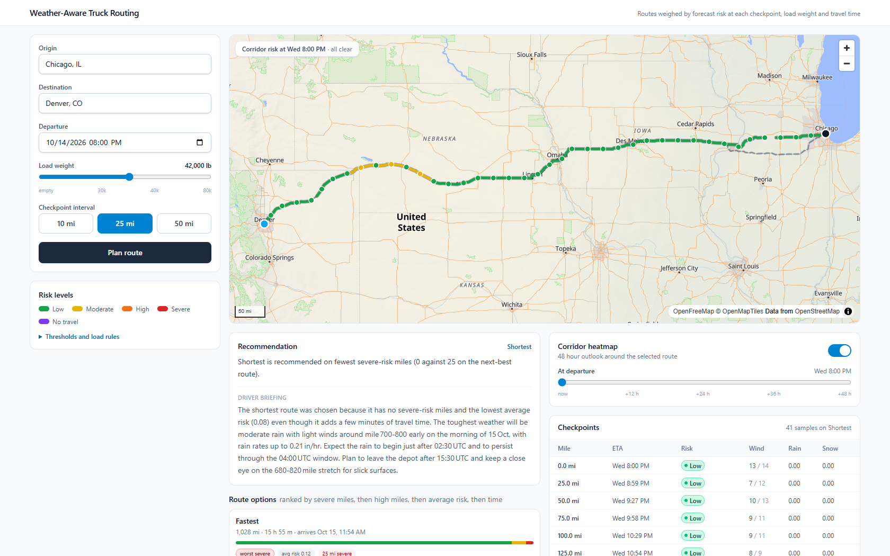

# Weather-Aware Truck Routing

Plan a truck trip against the weather it will actually meet. The app generates three truck
routes, samples the forecast at every checkpoint using the truck's estimated arrival time
there, scores each sample against the published wind/rain/snow thresholds and the load
weight, and recommends the route that balances weather risk against travel time.

- **Live app:** https://mujtabajunaid.github.io/weather-aware-truck-routing/
- **API:** https://weather-truck-routing-api-80a51d0956c5.herokuapp.com/api/v1/health
- **Stack:** React 19 + TypeScript + Vite + MapLibre GL · Django 5 + Django REST Framework



## What it does

1. Geocodes the origin and destination.
2. Builds three distinct truck routes (fastest, toll-free, shortest) with the load weight
   passed to the routing engine as a truck constraint.
3. Samples each route every 10, 25 or 50 miles. Each checkpoint carries the interpolated
   position *and* the interpolated elapsed driving time, so its forecast is read at the hour
   the truck is actually there.
4. Classifies every checkpoint by wind, rain and snow, then applies the load escalation
   rules.
5. Ranks the routes and recommends one, deterministically.
6. Draws everything on the map: risk-coloured route segments, per-checkpoint detail, and a
   48-hour weather heatmap over the trip corridor with an hour slider.

## Risk rules

| Condition | Low | Moderate | High | Severe | No travel |
|---|---|---|---|---|---|
| Wind | <25 mph | 25–34 | 35–44 | 45–54 | ≥55 |
| Rain | <0.10 in/hr | 0.10–0.25 | 0.25–0.50 | 0.50–1.00 | >1.00 |
| Snow | <0.5 in/hr | 0.5–1.0 | 1.0–2.0 | 2.0–3.0 | >3.0 |

Load rules, applied on top of the bands:

- Wind ≥55 mph is no travel for any load.
- Wind 45–54 mph with more than 30,000 lb is no travel.
- Wind 35–44 mph with more than 40,000 lb is severe.

A checkpoint takes the worst level produced by any of the four inputs, and the response
reports which one drove it.

**Boundary reading.** The published table has touching endpoints ("0.10–0.25" then
"0.25–0.50"), so bands are implemented as lower-inclusive and upper-exclusive: 0.25 in/hr is
High, not Moderate. The three "no travel" cells are read exactly as printed — wind is `≥55`,
while rain `>1.00` and snow `>3.0` are strict, so rain of exactly 1.00 in/hr is Severe. Every
one of these edges is asserted in `backend/tests/test_risk.py`.

**Wind source.** Classification uses sustained wind (`wind_speed_10m`). Gusts are fetched and
displayed alongside each checkpoint but do not drive the level, since the thresholds are
written as wind speeds.

## Recommendation

Routes are ordered by the spec's preference list, each key breaking ties in the one before:

1. fewest no-travel miles
2. fewest severe miles
3. fewest high miles
4. lowest distance-weighted average risk
5. shortest travel time

No-travel mileage is promoted above severe as a hard viability gate: a route the load legally
cannot run is not a candidate, whatever its other numbers. Mileage is attributed to each
checkpoint by midpoint, so the per-level miles of a route always sum to its true length.

The recommendation is computed entirely in `backend/risk/`, which has no I/O and no framework
imports. When a `GROQ_API_KEY` is configured, a language model writes the prose driver
briefing **from that already-made decision**; it never ranks or re-ranks anything, and with no
key the UI falls back to the generated reason string. `briefing_source` in the response says
which one you are reading.

## Third-party services

Everything on the critical path is free, keyless and open-source, so the app runs with no
credential and no quota account:

| Role | Service | Licence | Key |
|---|---|---|---|
| Truck routing | [Valhalla](https://github.com/valhalla/valhalla) via the FOSSGIS public instance | MIT, OpenStreetMap data (ODbL) | none |
| Forecast | [Open-Meteo](https://open-meteo.com) hourly forecast | AGPL-3.0, free for non-commercial use | none |
| Geocoding | Open-Meteo geocoding, with [Nominatim](https://github.com/osm-search/Nominatim) as the address fallback | AGPL-3.0 / GPL-2.0 | none |
| Basemap | [OpenFreeMap](https://openfreemap.org) + OpenMapTiles | BSD/CC-BY, OSM data | none |
| Map renderer | [MapLibre GL JS](https://maplibre.org) | BSD-3-Clause | none |

The only optional credential is `GROQ_API_KEY`, used solely for the narrated briefing. Public
instances are used under fair-use terms, and calls to Nominatim are serialised to respect its
one-request-per-second policy. For production traffic you would self-host Valhalla and
Nominatim and point `VALHALLA_URL` / `NOMINATIM_URL` at them.

## Performance notes

The naive implementation took roughly 50 seconds for a Chicago→Denver plan. Three measurements
shaped the current design:

- **Open-Meteo costs ~0.4 s per location, independent of payload size.** 120 points with one
  variable for two hours took as long as 120 points with four variables for four days. So
  forecast lookups are snapped to a shared ~0.3° grid (`WEATHER_SNAP_DEGREES`) and cached per
  cell. Checkpoints that fall in one cell share one lookup, which is why a 10-mile interval
  costs the same as a 50-mile one — 309 checkpoints still resolve to about 79 cells.
- **It rejects heavy concurrency** with `429 Too many concurrent requests`, so requests are
  split into exactly `MAX_PARALLEL_REQUESTS` chunks and issued in a single wave.
- **The original geocoder was the slowest link.** Photon answered in 7–12 s locally and 31–37 s
  from the dyno — past Heroku's 30 s request limit on its own. Open-Meteo's geocoder answers
  city queries in about 1 s and became the primary; Nominatim, at well under 1 s from the dyno,
  is now the fallback for street addresses.

Result: ~10 s cold, and 0.2–0.4 s once warm. Because routes and forecast cells are cached,
changing the checkpoint interval re-scores from cache without re-routing or re-fetching. Route
geometry is simplified (Ramer–Douglas–Peucker) and polyline-encoded before transport, and the
heatmap scrubber only swaps the weight on an existing GeoJSON source rather than refetching.

## API

Base path `/api/v1`.

| Method | Path | Purpose |
|---|---|---|
| GET | `/health` | liveness |
| GET | `/places?q=&limit=` | geocoder suggestions |
| POST | `/trips/plan` | routes, checkpoints, risk, recommendation |
| POST | `/trips/heatmap` | 0–48 h corridor risk grid for one route |

```bash
curl -X POST https://weather-truck-routing-api-80a51d0956c5.herokuapp.com/api/v1/trips/plan \
  -H 'Content-Type: application/json' \
  -d '{"origin":"Chicago, IL","destination":"Denver, CO",
       "departure_time":"2026-10-15T14:00:00Z",
       "load_weight_lb":42000,"checkpoint_interval_miles":25}'
```

Validation errors return 400, an unresolvable address or route returns 422, and an upstream
outage returns 503 rather than a 500.

## Layout

```
backend/
  risk/        thresholds, scoring, ranking - pure functions, no I/O
  providers/   one adapter per upstream service
  planning/    checkpoint sampling, corridor grid, orchestration, API
  core/        geometry, HTTP session, cache keys, error mapping
  tests/       71 tests, no network access
frontend/src/
  api/         typed client and wire types
  lib/         geometry, risk palette, formatters
  components/  form, map, route list, checkpoints, heatmap controls
  hooks/       query hooks
```

## Running locally

Backend:

```bash
cd backend
python -m venv .venv && .venv/Scripts/activate   # source .venv/bin/activate on macOS/Linux
pip install -r requirements.txt
python manage.py test tests
python manage.py runserver 8000
```

Frontend:

```bash
cd frontend
npm install
echo "VITE_API_BASE_URL=http://127.0.0.1:8000/api/v1" > .env.local
npm run dev
```

### Configuration

| Variable | Default | Purpose |
|---|---|---|
| `DJANGO_SECRET_KEY` | dev placeholder | Django signing key |
| `DJANGO_DEBUG` | `false` | debug mode |
| `DJANGO_ALLOWED_HOSTS` | localhost, `.herokuapp.com` | allowed hosts |
| `CORS_ALLOWED_ORIGINS` | localhost, GitHub Pages origin | browser origins |
| `WEATHER_SNAP_DEGREES` | `0.3` | forecast grid size; lower is more precise and slower |
| `API_THROTTLE_RATE` | `60/min` | per-IP throttle protecting the free upstreams |
| `GROQ_API_KEY` | empty | optional; enables the narrated briefing |
| `VALHALLA_URL`, `NOMINATIM_URL`, `OPEN_METEO_URL`, `OPEN_METEO_GEOCODING_URL` | public instances | point at self-hosted instances |

## Deployment

The backend runs on Heroku from the `backend/` subtree; the frontend is built by GitHub
Actions and published to GitHub Pages. The Pages build reads the API origin from the
`VITE_API_BASE_URL` repository variable.

```bash
git subtree push --prefix backend heroku main
```

## Limitations

- Forecast lookups are snapped to a ~0.3° grid, so a checkpoint's reading can come from up to
  roughly 15 miles away. Lower `WEATHER_SNAP_DEGREES` to trade latency for precision.
- Departure must fall within the forecast window (12 hours back to 13 days ahead).
- The public Valhalla and Nominatim instances carry no availability guarantee; outages surface
  as a 503 with a readable message.
- Forecasts are guidance. The driver remains responsible for the go/no-go decision.

## Licence

[MIT](LICENSE)
